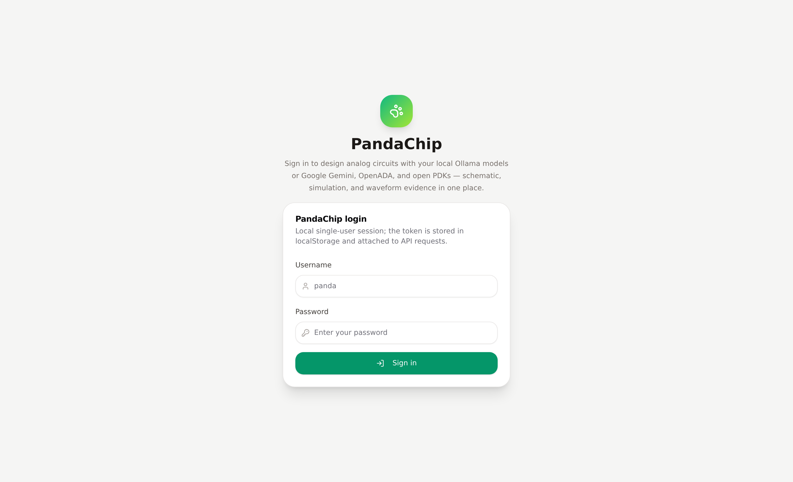
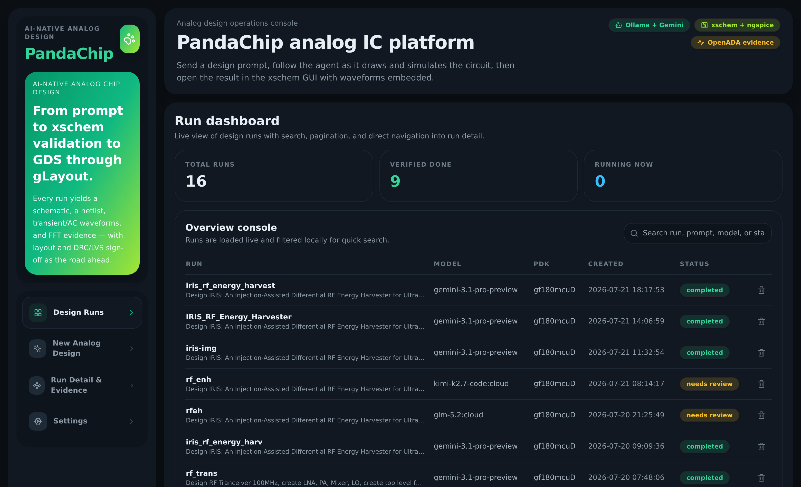
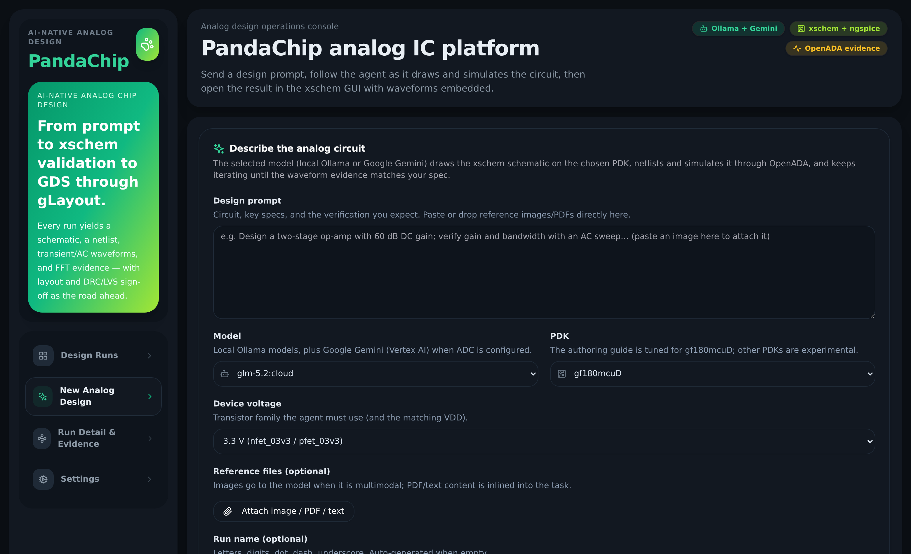
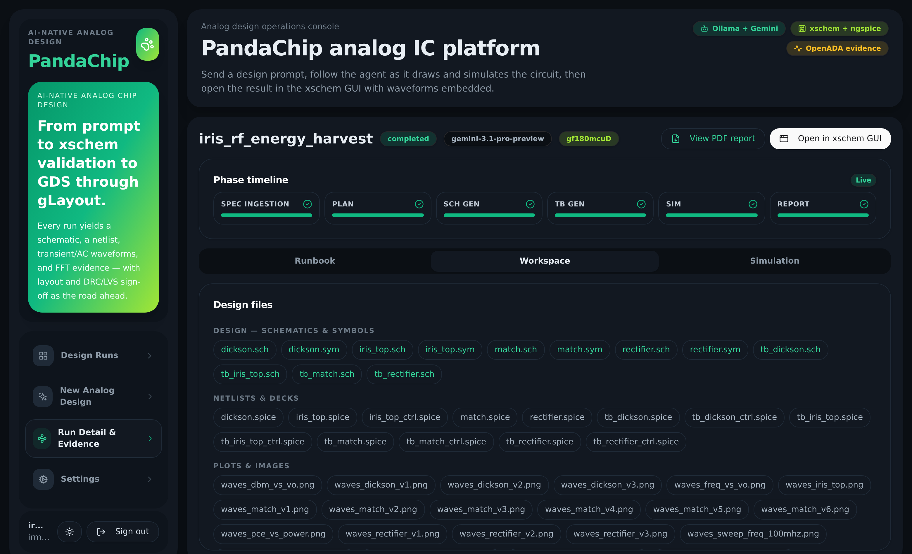
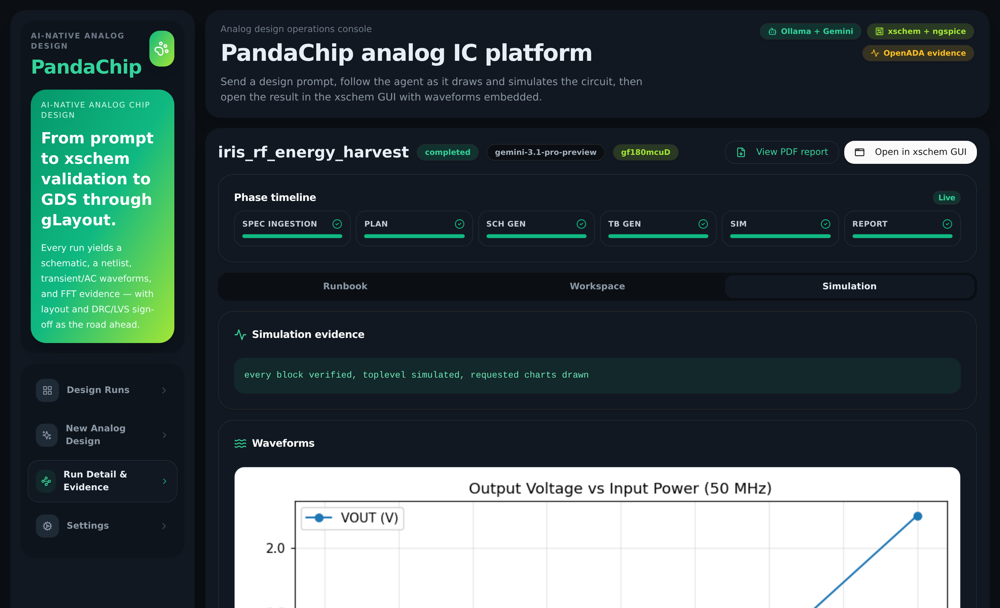
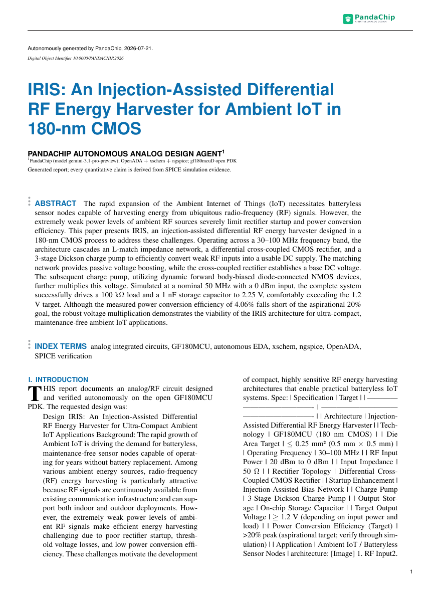

# PandaChip

AI for analog circuit generation.

Send a prompt — PandaChip's agent (Ollama `glm-5.2:cloud`, or Google
Gemini through Vertex AI) designs a real xschem schematic on the GF180MCU
open PDK, netlists and simulates it through
[OpenADA](https://github.com/simra-tech/OpenADA)'s agent–EDA contract, and
verifies the waveform evidence (FFT mixing products, AC gain, oscillation)
before it calls the job done.

```text
   React web app (frontend/) → Go server (web/)  ──or──  CLI
                 │  prompt
                 ▼
   Ollama (glm-5.2:cloud)  ──or──  Google Gemini (Vertex AI, ADC)
                 │  tool calls
                 ▼
      pandachip/  agent harness
      write_file · netlist · simulate · analyze_raw (FFT/AC)
                 │
                 ▼
        OpenADA CLI (vendored in src/, MIT)
        versioned intent in → auditable evidence out
                 │
                 ▼
        toolbin/* wrappers (docker exec)
                 │
                 ▼
   pandachip-eda container — IIC-OSIC-TOOLS
   xschem 3.4.8 · ngspice 46 · gf180mcuD PDK (3.3 V devices)
```

## The platform









## Latest run: IRIS RF energy harvester

`iris_rf_energy_harvest` — an injection-assisted differential RF energy
harvester on GF180MCU, designed end-to-end by `gemini-3.1-pro-preview`:
an L-match network, a differential cross-coupled CMOS rectifier and a
3-stage Dickson charge pump, each verified as a block and then integrated
in `iris_top.sch`. At 0 dBm / 50 MHz the harvester delivers **VOUT 2.25 V**
(target ≥ 1.2 V) into 1 nF ∥ 100 kΩ, turns on around −10 dBm, and peaks at
4.06 % PCE.





## Repository layout

| Path | What it is |
|---|---|
| `pandachip/` | Agent harness: tool-calling loop (`agent.py`), Google Gemini/Vertex-AI backend over ADC (`gemini.py`), OpenADA bridge (`eda_tools.py`), ngspice rawfile reader + FFT/AC evidence (`rawread.py`), plotting (`plot_raw.py`, `autoplot.py`), verified xschem+GF180 authoring guide (`prompts/`), web frontend (`static/`) |
| `src/` | Complete OpenADA 0.4.0 tree (runtime, schemas, profiles, skills, conformance, docs). Claude/Codex plugin adapters removed — Ollama is the only LLM path |
| `frontend/` | React + Vite + Tailwind web app (adapted from the Chip-Orchestra frontend): login → design runs → new design → run detail with waveforms and an "Open in xschem GUI" action |
| `web/` | Go API server (stdlib `net/http`, chip-orchestra-style `cmd/` + `internal/` layout): serves `frontend/dist`, local login, run spawning, artifacts, xschem launch |
| `toolbin/` | `xschem`, `ngspice`, `netgen`, `klayout`, `magic` wrappers that `docker exec` into the `pandachip-eda` container with `PDK=gf180mcuD` |
| `scripts/` | `run.sh` (build + serve the web platform), `start_eda_container.sh`, `xschem_gui.sh` (open schematic in GUI), `run_three_designs.sh` (mixer + LNA + LO demo builds) |
| `designs/` | Run workspaces: task, schematic, netlist, sim evidence, transcript, outcome |
| `.venv/` | Python env with `openada` installed editable from `src/` |

## Setup

Prerequisites: Docker with `hpretl/iic-osic-tools` pulled, Ollama with
`glm-5.2:cloud` (`ollama list`), Python 3.10+, `uv`, Go 1.18+, an X display.
Optional, for Gemini models: the `gcloud` CLI logged in with Application
Default Credentials against a project with the Vertex AI API enabled.

```bash
# 1. Python env + OpenADA
uv venv .venv --python "$(command -v python3)" --system-site-packages
uv pip install -e ./src --no-deps --python .venv/bin/python
# (--system-site-packages supplies jsonschema/numpy/matplotlib from the host
#  python; with PyPI access you can instead: uv pip install -e ./src jsonschema numpy matplotlib)

# 2. EDA runtime (xschem/ngspice/PDK live in the container)
scripts/start_eda_container.sh

# 3. Verify the contract end to end
PATH=$PWD/toolbin:$PATH .venv/bin/openada doctor --tool ngspice --require ngspice
PATH=$PWD/toolbin:$PATH .venv/bin/openada simulate \
  src/fixtures/smoke/smoke_ngspice.cir --output-dir /tmp/pandachip-smoke

# 4. (optional) Google Gemini via Vertex AI — ADC, no API key
#    Needs the gcloud CLI and a GCP project with the Vertex AI API enabled.
gcloud auth application-default login   # writes ~/.config/gcloud/application_default_credentials.json
cp .env.example .env                    # then set GOOGLE_CLOUD_PROJECT=<your-project-id>

# 5. Web platform (builds frontend + Go server when needed, then serves)
scripts/run.sh                        # http://localhost:8317
```

With ADC in place the model dropdown offers `gemini-3.1-pro-preview`,
`gemini-3.5-flash`, and `gemini-2.5-pro` next to the local Ollama models
(override the list with `PANDACHIP_GEMINI_MODELS`). The Gemini backend
(`pandachip/gemini.py`) needs no Google SDK: it refreshes the ADC OAuth
token and calls Vertex AI `generateContent` directly, with the same tool
set and multimodal (reference image) support as the Ollama path — CLI runs
work too via `--model gemini-3.1-pro-preview` (export `GOOGLE_CLOUD_PROJECT`
or rely on the ADC quota project).

Notes baked into this setup (learned the hard way):

- The distro xschem 2.8.1 (2018) segfaults when netlisting; the container's
  xschem 3.4.8 is used for everything, including the GUI (X11 socket mounted,
  windows appear on your display).
- GF180 decks must include `design.ngspice` *before*
  `.lib sm141064.ngspice typical`, or ngspice fails with
  `Undefined parameter [sw_stat_mismatch]`.
- ngspice lowercases unquoted `source` paths in control scripts, so the
  container mounts the repo at a lowercase alias (`/home/irman/pandachip`)
  next to the real path — OpenADA control-mode simulation works from both.
- Decks with PDK `.lib`/`.include` lines are automatically run through
  OpenADA's ngspice **control mode** with declared deck-owned rawfiles;
  clean decks use batch mode. A deck may carry one `.tran` plus one `.ac`;
  the runtime then produces `<name>_tran.raw` and `<name>_ac.raw`.

## Using it

Web: `scripts/run.sh`, open http://localhost:8317, sign in (any username/password —
local single-user session), then submit a prompt from **New Analog Design**
and watch the agent iterate (schematic → netlist → simulate → FFT/AC
evidence). Each run page shows waveform plots inline plus an
**Open in xschem GUI** button that opens the schematic on the workstation
display with its waveforms embedded.

CLI:

```bash
.venv/bin/python -m pandachip.agent --task-file designs/task-dbm.md --workdir designs/dbm
scripts/xschem_gui.sh designs/dbm/dbm_tb.sch designs/dbm/sim/dbm_tb.raw
```

Each workspace records `preflight.json` (OpenADA scoped preflight,
assertion `spice-analysis-evidence-valid`), `transcript.json` (every tool
call), and `outcome.json`.

## Demo builds

`scripts/run_three_designs.sh` runs three GLM 5.2 tasks sequentially:

| Design | File | Analyses | Verification |
|---|---|---|---|
| Double balanced mixer (Gilbert cell) | `designs/dbm/dbm_tb.sch` | `.tran` | FFT: 1 MHz + 9 MHz products (fRF±fLO, RF=5 MHz, LO=4 MHz) dominate feedthrough at the differential IF |
| LNA, ≥50 dB @ 40 MHz | `designs/lna/lna_tb.sch` | `.tran` + `.ac` | AC: gain ≥ 50 dB at 40 MHz; TRAN: 40 MHz output ≥ 0.25 V from 1 mV input |
| Local oscillator (ring) | `designs/lo/lo_tb.sch` | `.tran` | Sustained rail-to-rail oscillation, dominant FFT peak reported — **verified: 103 MHz, 3.3 Vpp, 5 stages, 23 steps** |
| IRIS RF energy harvester, hierarchical (`match.sym` + `rectifier.sym` + `dickson.sym` in `iris_top.sch`, per-block testbenches) | `designs/iris_rf_energy_harvest/iris_top.sch` | `.tran` + power/frequency sweeps | Every block verified, then the top level: **VOUT 2.25 V ≥ 1.2 V target at 0 dBm / 50 MHz**, turn-on ≈ −10 dBm, L-match resonance at 50 MHz, 4.06 % peak PCE — `gemini-3.1-pro-preview`, charts and waveform panes embedded (see the showcase above) |

All device models are the real GF180MCU BSIM models (`nfet_03v3` /
`pfet_03v3`); hand-written `.model` substitutes are explicitly forbidden by
the agent's authoring guide.

Verified mixer result (GLM 5.2 cloud, 5 autonomous steps, 10 µs / 1 ns
transient, 10,008 points): differential IF shows 1 MHz and 9 MHz mixing
products at 322 mV each (conversion gain ≈ 10.2 dB from the 100 mV
differential RF), higher-order 3fLO±fRF terms 3.5× lower, and both RF and
LO feedthrough absent from the top spectral peaks — textbook double-balanced
behaviour. The schematic carries autoloading xschem graph panes
(`pandachip/embed_graphs.py`), so opening it in the GUI shows the transient
waveforms immediately.

## Verification gates (a run cannot lie)

The harness enforces engineering quality; the model cannot mark a run
complete by assertion alone:

- `netlist_schematic` **rejects** schematics that are not really drawn:
  label-only connectivity (wire count below component count) or stacked
  symbols come back as `sch.quality` errors the agent must fix.
- `done(spec_met=true)` is **auto-rejected** unless, in the session, a
  simulation completed, `analyze_raw` covered the key node of every stage
  (input, intermediates, output), every schematic passes the wiring check,
  and waveform plots were generated from the rawfiles. After three
  rejections the outcome is recorded honestly as `spec_met=false`.
- Waveform panes (`pandachip/embed_graphs.py`, autoload) are embedded into
  **every** schematic — hierarchical blocks included, matched through
  `x1.node` names — as soon as analysis evidence exists, so opening any
  .sch in the xschem GUI shows its simulation immediately.
- Hierarchical designs are first-class: block `.sch` + `.sym` pairs
  instantiated in one top-level testbench (see the IRIS harvester above
  and the authoring guide).

When a run ends as **needs review**, the run page shows AI suggestions —
the run's own model reviews the outcome, transcript and schematic-quality
report (`pandachip/suggest.py`, cached in `suggestions.json`) and proposes
concrete fixes — next to a **Retry** button that resumes the agent with a
fresh step budget (`/api/suggest/<id>`, `/api/resume/<id>`).

The agent can also research online, Chip-Orchestra-style
(`pandachip/research.py`, stdlib-only): `search_web` answers topology /
sizing / error-fix questions through SearXNG (`SEARXNG_URL`), Gemini
google-search grounding (same ADC), or the GitHub + Wikipedia APIs, and
`fetch_reference` pulls one page into the run's `context/refs/` — every
digest stays inside the workspace as part of the evidence trail. Toggle
with `PANDACHIP_WEB_RESEARCH` in `.env`.

## What OpenADA provides here (and what it doesn't)

OpenADA is the deterministic contract between the agent and the EDA tools:
`doctor` (preflight), `netlist` (xschem), `simulate` (ngspice batch/control
with evidence envelopes), plus `drc`, `lvs`, `rtl-check`, `rtl-lint`,
`synthesize`, `timing-analyze`, `extract`/`measure`/`spectral`/`transfer`/
`evaluate`, `profile`, and `provider` — 16 command families over 8 EDA
drivers. It deliberately does **not** create or edit schematics (design
mutation is outside its 0.4.0 preview) and contains no LLM integration —
that is exactly the layer PandaChip adds: schematic authoring by the model
and Ollama tool-calling, with every EDA action still going through the
unmodified OpenADA CLI.

## Credits

- [OpenADA](https://github.com/simra-tech/OpenADA) © Simra Tech, MIT.
- [IIC-OSIC-TOOLS](https://github.com/iic-jku/IIC-OSIC-TOOLS) container.
- GF180MCU PDK © GlobalFoundries PDK Authors, Apache-2.0.
